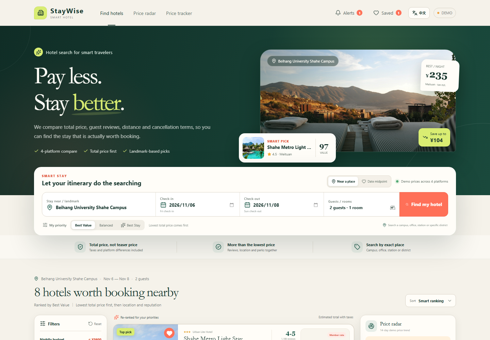
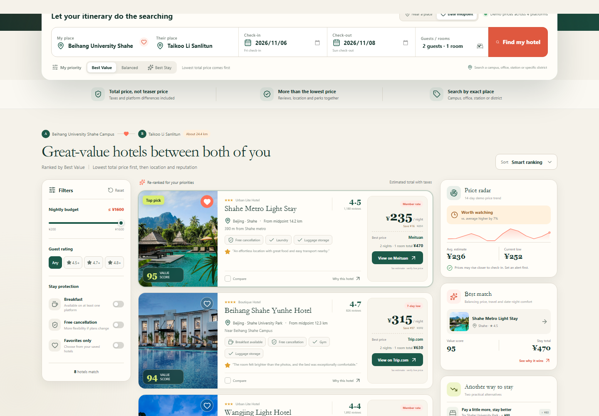
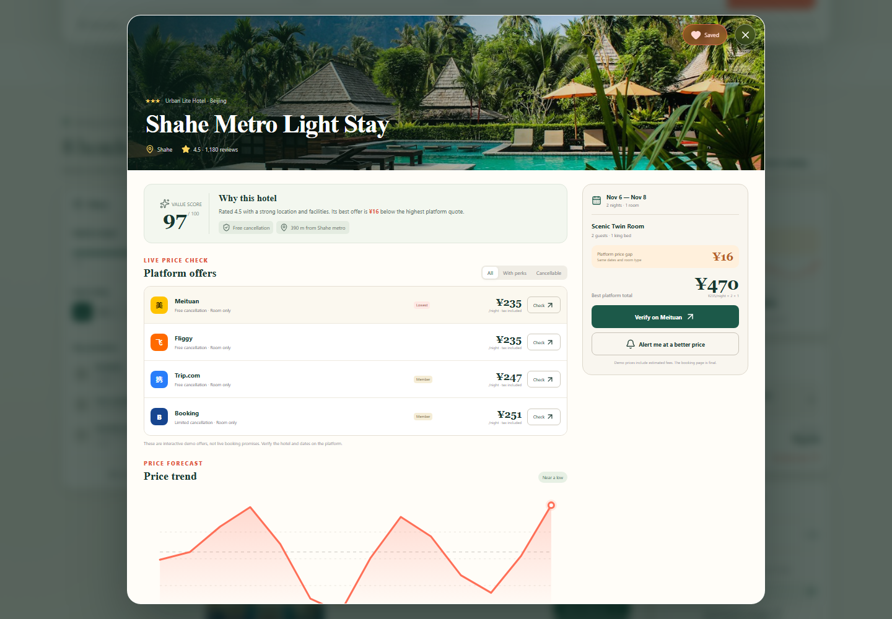
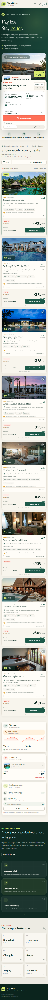

# StayWise

**English** | [简体中文](README.zh-CN.md)

StayWise is a bilingual hotel search demo that helps you find the lowest useful total price near a specific place. It goes beyond a single room rate by comparing taxes, guest ratings, distance, breakfast and cancellation terms across multiple booking platforms.

It also includes a **date midpoint** mode: enter both people's locations, and StayWise ranks affordable hotels around a practical meeting point. There are no fake "best hotel" claims—every recommendation exposes the price and trade-offs behind it.



## Highlights

- **Search by exact place**, including campuses, offices, stations, landmarks and neighborhoods.
- **Price-first ranking** for travelers who care most about the lowest total cost.
- **Date midpoint mode** that balances price, distance to the midpoint and travel distance from both locations.
- **Four-platform comparison** with a clear lowest-price platform and full-stay total.
- **Preview imagery** on every hotel card and in the detail view.
- **One-click Chinese / English switching**, persisted locally.
- Budget, rating, breakfast, free-cancellation and favorites filters.
- Compare up to three hotels side by side.
- 14-day demo price trend, local price alerts and a persistent shortlist.
- Responsive layouts for desktop, tablet and mobile.

## Date Midpoint Search

Enter two places in the same city. StayWise calculates an approximate midpoint, then reranks hotels by:

1. Lowest total price.
2. Distance from the meeting midpoint.
3. Travel distance from both starting points.
4. Guest rating and included perks.



Try it with:

- My place: `Beihang University Shahe Campus`
- Their place: `Taikoo Li Sanlitun`

Distances are straight-line estimates for this offline demo, not live driving or transit times.

### Hotel Preview and Offer Comparison

Every card includes a room-space preview. The detail view shows platform offers, perks and the total for the full stay.



## Quick Start

### Windows

Double-click [`启动住得值.cmd`](启动住得值.cmd). The launcher installs dependencies if needed, builds the app, starts a local server and opens the browser.

If your browser does not open automatically, visit `http://127.0.0.1:4173`.

### Terminal

```bash
npm install
npm start
```

For development:

```bash
npm run dev
```

Production build:

```bash
npm run build
npm run preview
```

## Search Example

1. Switch to **Near a place**.
2. Type `Beihang University Shahe Campus` or `北航沙河`.
3. Choose the matching suggestion.
4. Set dates, guests and rooms.
5. Keep **Best Value** selected to prioritize the lowest real total.

## Recommendation Model

The sort model is transparent and editable in `src/utils/hotelLogic.js`.

| Priority | Price weight | Rating weight | Location weight | Perks weight |
| --- | ---: | ---: | ---: | ---: |
| Best Value | 72% | 12% | 8% | 8% |
| Balanced | 48% | 24% | 16% | 12% |
| Best Stay | 24% | 38% | 20% | 18% |

The displayed **Value Score** normalizes price, review score, distance and included benefits within the current result set.

## Localization

Use the `EN / 中文` button in the header. The selected language is stored in `localStorage`, and the document title and accessibility labels update as well.



## Project Structure

```text
src/
  App.jsx                    Application state and search flow
  i18n.jsx                   Chinese / English language context
  data/
    hotels.js                Demo hotels and offers
    locations.js             Offline landmark index and distance helpers
  components/
    SearchPanel.jsx          Place, date and midpoint search
    LocationPicker.jsx       Searchable location suggestions
    HotelCard.jsx            Hotel preview cards
    FilterSidebar.jsx        Price and stay filters
    PriceInsights.jsx        Price radar and alternative picks
    PriceChart.jsx           SVG trend chart
    Overlays.jsx             Detail, compare, alert and shortlist views
  utils/hotelLogic.js        Price, date, distance and ranking logic
launch.mjs                   One-click production launcher
scripts/visual-check.mjs     Playwright functional and visual checks
```

## Demo Data and Live Integration

All hotels, availability, ratings, platform prices and trends in this repository are **interactive demo data**. They are not live inventory and do not constitute a booking guarantee. Platform buttons open official sites so users can verify a real price.

For production use, connect a licensed hotel distribution, affiliate or direct channel API. The minimum normalized offer should include:

```json
{
  "hotelId": "provider-hotel-id",
  "roomTypeId": "provider-room-id",
  "hotelName": "Hotel name",
  "placeId": "geocoded-place-id",
  "rating": 4.8,
  "reviewCount": 1820,
  "latitude": 40.1024,
  "longitude": 116.2707,
  "offers": [
    {
      "provider": "provider-name",
      "currency": "CNY",
      "roomPrice": 588,
      "tax": 35,
      "breakfast": true,
      "freeCancellation": true,
      "cancellationDeadline": "2026-11-05T18:00:00+08:00",
      "bookingUrl": "https://..."
    }
  ]
}
```

Never merge offers unless the provider, room type, occupancy, dates and cancellation terms match.

## Verification

```bash
npm run build
npm run dev -- --port 4173
npm run test:visual
```

The Playwright check covers exact-place search, date midpoint search, bilingual switching, filters, favorites, price alerts, hotel comparison and desktop/mobile overflow.

## Image Credit

Demo hotel photography is sourced from Unsplash for interface presentation. Hotel names and images are not intended to represent the same real property.

## License

MIT © 2026 Huiteng Zhuang
